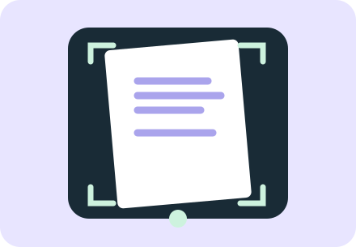
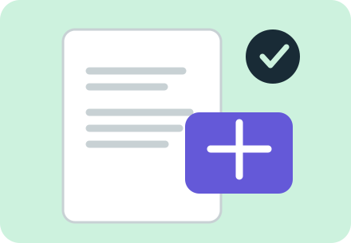
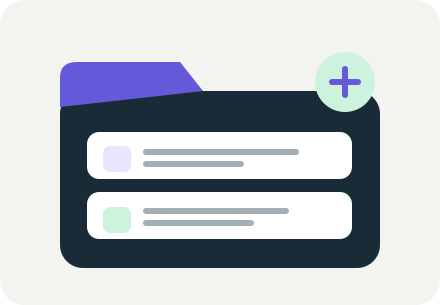

  

<h1 align="center">pagomi.</h1>

<strong>PDF Scanner &amp; Editor</strong>

Scan. Edit. Create. Your everyday documents, beautifully handled.

  <a href="https://github.com/bren-wp/pagomi/releases"><strong>Explore downloads</strong></a>
  &nbsp; · &nbsp;
  <a href="PRIVACY.md">Your privacy</a>

---

## A little less paperwork. A lot more possibility.

From the receipt in your pocket to the document you need to sign, **pagomi.** brings your pages together in one beautiful place.

<table>
<tr>
  <td width="33%" align="center"></td>
  <td width="33%" align="center"></td>
  <td width="33%" align="center"></td>
</tr>
<tr>
  <td align="center"><strong>📷 Scan with confidence</strong></td>
  <td align="center"><strong>✏️ Edit in a moment</strong></td>
  <td align="center"><strong>📂 Keep it together</strong></td>
</tr>
<tr>
  <td align="center">Capture, straighten, crop and enhance.</td>
  <td align="center">Merge, split, sign, compress and protect.</td>
  <td align="center">Find, organize, export and share.</td>
</tr>
</table>

## Your best work starts with a page.

**✨ Beautiful scans**  
Turn notes, receipts, books, forms and ID cards into polished PDFs. Smart page detection helps you capture the whole picture.

**🔎 Text you can actually find**  
Search and copy the words in your scans with on-device text recognition.

**🪄 Powerful PDF tools, made simple**  
Combine pages, rearrange them, add a signature, watermark a document, compress a file or protect it with a password.

**☁️ Your files, your choice**  
Keep your documents on your phone. Share or export whenever you want, with optional Google Drive synchronization.

**🔐 Thoughtful about privacy**  
No mandatory account. No ads. No analytics. Core document processing takes place on your device.

---

<strong>Less clutter. More done.</strong>

Made for the moments when paperwork shouldn't get in the way.

<strong>pagomi.</strong> — Scan. Edit. Create.

